<p align="center">
  
</p>

<h1 align="center">Also</h1>

<p align="center">A floating note for your Mac. One click to show it, one click to hide it.</p>

<p align="center"><a href="https://github.com/graemeswinton/also/releases/latest/download/Also.zip"><strong>Download Also</strong></a> &nbsp;·&nbsp; <a href="../../releases/latest">Release notes</a></p>

---

Also is a single, quiet note that lives in your menu bar. Click the icon and your note appears where you left it. Click again and it's gone. Paste in text from anywhere and it takes on Also's own clean type, so you never end up with a mess of fonts.

## Features

- **Menu bar show and hide.** Click the icon to bring the note up, click again to put it away. No Dock icon.
- **Clean paste.** Text pasted from web pages, emails or PDFs drops its formatting and matches the note.
- **Faint lines between notes.** Press Return after a note and a soft line separates it from the next.
- **Frosted window.** Translucent when you're elsewhere, almost white when you're writing. Follows light and dark mode.
- **Three fonts.** SF Pro, New York and SF Mono, at any size from 10 to 40pt.
- **Keep on top.** Optionally floats above other windows, and shows on every desktop.
- **Saves as you type.** Reopens with your text, at the same size and position.
- **Opens at login.** Turn it off any time.
- **Private.** Your note is a plain text file on your Mac. Nothing is uploaded and there's no account.

## Install

1. [Download Also.zip](https://github.com/graemeswinton/also/releases/latest/download/Also.zip). On the release page, it's the file under **Assets**, not "Source code".
2. Double-click it to unzip, then drag **Also** into your **Applications** folder.
3. Open Also. macOS will warn that it can't verify the developer, because Also isn't registered with Apple. Click **Done**.
4. Open **System Settings → Privacy & Security**, scroll down and click **Open Anyway** next to the message about Also. Confirm with your password.

You only need to do steps 3 and 4 once. Also then appears as an icon in your menu bar.

Requires a Mac with Apple Silicon (M1 or later) and macOS 12 Monterey or later.

## Using Also

| Action | How |
| --- | --- |
| Show or hide the note | Click the menu bar icon |
| Settings and Quit | Right-click the menu bar icon |
| Fonts and size while writing | Right-click inside the note |
| Sans, Serif, Mono | ⌘1, ⌘2, ⌘3 |
| Bigger, smaller, default size | ⌘=, ⌘–, ⌘0 |
| Keep on top | ⌘⇧T |
| Hide the note | ⌘W or the close button |

Your note is stored at `~/Library/Application Support/Also/note.txt`.

## Build from source

You'll need Apple's Command Line Tools (`xcode-select --install`) or Xcode. Download or clone this repository, then in Terminal:

```
bash install.sh
```

This builds Also and puts it in your Applications folder. To build without installing, run `bash scripts/build.sh` and find the app in `build/`.

## Releasing a new version

Push a tag such as `v1.1`. GitHub Actions builds Also.app and publishes it on the Releases page.

## Licence

MIT. See [LICENSE](LICENSE). The menu bar icon is from [Lucide](https://lucide.dev) under the ISC licence. See [THIRD_PARTY_NOTICES.md](THIRD_PARTY_NOTICES.md).

Made by Graeme Swinton in Bristol.
